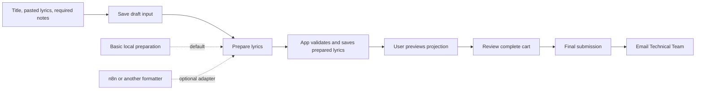

# Song Cart: User Flow and Persistence

## Status

The newer [submission management design](submission-management.md) replaces this
document's per-song notes with one user comment thread per submission and introduces
Pending, first-view Technical Team confirmation, rejection, and email responses.
Use that design for these areas; the remaining song preparation decisions below
still apply. The submission interview is in progress.

Product decisions and operational edge cases agreed, including draft-only user and
admin reordering. Build the basic experience first, with optional,
replaceable lyrics formatting integrations. The implementation shape below remains
a design specification; this document does not authorize application changes.

## Confirmed Requirements

- Existing signed-in users prepare song carts.
- Service dates include Sundays and other days.
- There are three fixed, ordered service sections: Call to Worship, Praise, Worship.
- Users add songs to a chosen section directly from Song Catalog search.
- Unlisted-song forms require a title, pasted lyrics, and notes.
- Every selected catalog song can have optional notes.
- Users can preview lyrics before final submission. External formatting is optional:
  n8n can be plugged in or replaced without changing the core cart experience.
- The baseline uses the agreed 45-character wrapping and two lyric lines per slide,
  preserving the supplied words and order, with formatted text handoff to the team.
- One personal cart per user and date, final submissions locked, and one configured
  Technical Team email address are the agreed initial scope.
- Users can review every selected song before checkout.
- Song order defaults to addition order. Users can reorder by drag and drop in the
  UI, and reordering is also available in the admin panel. Both are limited to drafts.
- Preserve the reviewed lyric/slide content in the final submission.
- Allow catalog selections with unavailable previews, clearly marked; the team can
  look up the song by title in EasyWorship.
- Sections may be empty, but the complete cart must contain at least one song.
- The team email contains enough information and text handoff to act without signing
  into the application.
- Corrections after final submission are handled directly with the Technical Team.
- Checkout is final submission, followed by notification of the Technical Team.
- Email is the first notification channel.

## Working Vocabulary

Canonical definitions live in [CONTEXT.md](../../CONTEXT.md).

| Term | Meaning | Status |
| --- | --- | --- |
| Song Catalog | Searchable imported songs; source for selections. | Existing |
| Service Date | Calendar date for which songs are requested. | Confirmed concept |
| Song Cart | Song selection being prepared for a service date. | Existing |
| Service Section | Call to Worship, Praise, or Worship, distinct from a song's Verse or Chorus. | Confirmed |
| Selected Song | One catalog or unlisted song placed in one service section of a cart. | Agreed |
| Song Order | Intended sequence within a service section; defaults to addition order and can be rearranged. | Agreed |
| Unlisted Song | A requested song the user cannot find in the Song Catalog. | Confirmed concept |
| Song Notes | Context or preparation instructions accompanying a selected song. | Confirmed concept |
| Prepared Lyrics | Supplied lyrics formatted for projection preparation and preview. | Confirmed concept |
| Song Selection Submission | The recorded outcome of checkout, including who submitted and when. | Agreed |
| Technical Team | Church team preparing songs for service use. | Confirmed |
| Submission Notification | Email informing the Technical Team of a saved submission. | Agreed |

Use “Add to section” for adding from search and “Submit song selection” for checkout.
These are action labels, not additional domain entities.

## Agreed User Flow

1. Choose the service date once.
2. Search the Song Catalog.
3. Choose “Add to section,” then one of the three fixed service sections.
   If the song cannot be found, choose “Can't find a song?” and enter its title,
   lyrics, and notes. Preview the lyrics before submission; no external formatter
   needs to be installed or configured for this path to work.
4. Continue searching with the selection retained and visible in the cart.
5. Review all songs, notes, and available projection previews, grouped by service
   section, remove mistakes, and arrange songs in the intended order.
6. Submit the selection once.
7. Show submission outcome separately from email delivery outcome.

The desktop concept places the cart beside search. The mobile presentation still
needs to be resolved; it must offer the complete review before submission.

### Header Cart Indicator

The header uses a cart icon at every screen size. Its badge counts selected songs
in the active draft, including selections across sections; confirmed carts are
excluded. The icon opens that draft, with a link to cart history on the cart page.
The badge is hidden at zero and the accessible link name always includes the count.

Songs stay in the database. The existing Django session remembers the selected
service date through its session cookie, so reloads and later visits retain the
active cart until the session expires. With no remembered date, use the user's
most recently created draft. Read the count from the owner's saved cart on each
page render; do not trust a client-supplied count or duplicate song data in cookies.

### Unlisted Song Form

- Song title: required.
- Pasted lyrics: required.
- Song notes: required, including identifying details or preparation instructions.
- Service section: required, using the same three fixed choices.
- Actions: “Preview lyrics,” then “Add to cart.”

Save an unlisted song as an ordinary cart item
with no catalog identifier, include its notes in review and Technical Team email,
and leave the imported Song Catalog unchanged. Catalog selections have optional
notes; unlisted songs require notes. Uploads and a separate song approval workflow
are outside the initial scope. Users correct the source while the cart is a draft
and preview the changed result before submitting.

### Formatting Module and Replaceable Adapter

- Django owns cart persistence, user authorization, and final submission.
- A single lyrics preparation module accepts title and raw lyrics and returns
  ordered prepared lyric sections/slides. The caller does not know which adapter
  supplies formatting. Notes and user details are not formatting inputs.
- With no external adapter configured, use local word wrapping and slide breaks
  for preview/text output. There is no external call, model requirement, or worker.
- The optional n8n adapter receives the minimum formatting input through an
  authenticated server-to-server request. It returns content, not database writes.
- A different formatter can satisfy the same interface. No plugin registry,
  configurable pipeline graph, or dependency injection framework is needed.
- Formatting is preparation, not final submission, and sends no Technical Team email.
- Reuse the existing app projection renderer where the returned structure permits it.
- Preserve original pasted lyrics alongside the prepared result. Notes remain team
  instructions and are not projected as song lyrics.
- The user must review the result corresponding to the current input; changing input
  invalidates an earlier preview. Late responses must not overwrite newer input.
- Formatting failure retains draft input and offers retry, without treating a missing
  or invalid result as ready for final submission.
- Final submission retains the reviewed result rather than rerunning the formatter.
- Derive the formatted `.txt` handoff from the reviewed content. A native EasyWorship
  import file and direct library writes are outside the agreed initial scope.
  The current projection preview remains an approximation.

Optional n8n pattern: authenticated Webhook → validate/format → Respond to
Webhook. The Webhook can return workflow results to the calling application;
see [official n8n Webhook documentation](https://docs.n8n.io/integrations/builtin/core-nodes/n8n-nodes-base.webhook)
and [Respond to Webhook](https://docs.n8n.io/integrations/builtin/core-nodes/n8n-nodes-base.respondtowebhook).

### Archived Formatter Evidence and Reuse Proposal

At Git tag `archive/pre-song-catalog-pivot`, the following files document the earlier
intake workflow:

- `n8n/workflow/song-lyrics-intake-sub-workflow.md`
- `n8n/prompts/lyrics-formatter__song-lyrics-intake-sub-workflow.md`
- `n8n/prompts/song-lyrics-preprocessor__song-lyrics-intake-sub-workflow.md`

The workflow documentation is marked synced from live n8n on 2026-01-30. Current
live behavior has not been verified. It used the same section codes
`call_to_worship`, `praise`, and `worship`. The formatter returned `resolved_title`,
optional `artist`, and `formatted_lyrics`. A separate Pagination node wrapped at
45 characters and added slide breaks every two lyric lines.

The user agreed to these limits as the starting projection rules for this feature.
They have not been verified against the church's actual projection system.
The archived formatter instructed preservation of words
and order, with labels only where supported by the source. Its previous multi-song
splitting, section inference, and direct intake persistence are unnecessary for a
form that supplies one song with an explicit section.

For the optional integration, reuse the single-song formatting/pagination behavior, retain the
user's required title, and return the result for preview. Adapt only the transport
and persistence boundary needed for the cart. Do not reactivate the old intake
route or restore the archived scheduling app.

The current application already has ordered lyric sections/slides and a 16:9
projection preview. It does not generate a native EasyWorship import file.
Archived song downloads were formatted `.txt` files. The user agreed that text
handoff with the app preview is sufficient for the initial scope.

### Proposed Storage Extension

Keep the cart and its selected-song items as the initial relational model. Each
selected item would store optional catalog identity, title, section, and notes.
Store an explicit integer position within the section; insertion IDs cannot represent
a user-chosen order. A reviewed item retains available lyric/slide content and source
identity independently of subsequent catalog imports. An unlisted item additionally
retains the original pasted lyrics. Prepared structure uses the agreed ordered
sections/slides JSON representation. No separate
catalog import or song approval entity is needed for this proposal.

Formatting readiness and preview freshness must be enforced by the application;
the precise minimal fields depend on the agreed formatter contract. Required notes
for unlisted items and optional notes for catalog items need server-side validation.

## Existing Implementation Facts

These describe the current local implementation; the agreed design is not yet
implemented in full.

- `SongCart` stores an owner, date, draft/confirmed state, timestamps, and email status.
- A database constraint currently permits one cart per owner and date.
- `SongCartItem` stores cart, service section, stable catalog song identifier,
  selected title, and authors; ordering follows insertion IDs.
- The same song cannot be added twice to the same section. It can appear in both.
- Selections retain metadata independently of catalog snapshot pruning.
- Checkout locks and confirms a nonempty owned cart inside a transaction.
- Email runs after the transaction commits; failures retain the confirmed selection.
- Current recipients are all active staff users. This conflicts with the requirement
  to notify the Technical Team and requires a recipient model decision.
- Current confirmed carts cannot be edited, with manual email retries and no retry worker.

[ADR-0011](../adr/0011-confirm-service-song-carts.md) describes earlier implementation
assumptions. [ADR-0012](../adr/0012-prepare-service-song-carts-with-optional-formatting.md)
supersedes its product scope and recipient choices.
The current implementation also has only two sections, no unlisted-song form or
song notes, and no n8n formatting integration; these requirements remain design work.

## Delivery Order

### Phase 1: Core Experience

- Three sections, direct catalog adding, complete cart review, and notes.
- Reorder songs in the user UI and admin panel, with a shared persisted song order.
- Required title, lyrics, and notes for an unlisted song.
- Save draft input and prepared content in the existing cart/item model.
- Local projection preparation, preview, and formatted text handoff.
- Final submission and email to the configured Technical Team address.
- Persist submission independently of notification outcome; retain manual retry.

### Phase 2: Optional Formatter

- Connect n8n to the same preparation interface when a workflow is available.
- Validate returned content; protect against late responses overwriting newer input.
- Retain input on failures and offer retry or deliberate return to local preparation.
- Require review of the actual chosen result before submission.

## Limits

- One target service per date and personal carts; no shared editing.
- Submitted selections stay locked; replacement/amendment workflows are deferred.
- No automatic email retry worker or exactly-once email delivery guarantee.
- Catalog rights checks continue to govern lyric and projection visibility.
- Actual team email configuration and projector compatibility are environment checks
  for implementation/deployment, not new product entities.

## Persistence Principles

- Save meaningful domain records rather than UI layout or browser state.
- Store section choice per selected song; all three fixed headings can be rendered even
  when a section contains no songs.
- Keep submission success separate from email delivery success.
- Preserve enough catalog provenance for the Technical Team's actual preparation task.
- Prefer existing Django/PostgreSQL facilities; add a separate service, submission,
  or notification record only when the agreed lifecycle requires it.
- Retain the unique owner/date cart constraint and item foreign key. Add fields and
  constraints required by unlisted songs; avoid speculative indexes or job tables.

## Agreed Operational Edge Cases

User decisions recorded on 2026-10-10. These remain design decisions, not
authorization to implement application changes.

| Decision | Concrete problem | Agreed behavior |
| --- | --- | --- |
| Team handoff | The existing email links to staff-only admin; a configured team mailbox cannot open it. | Email the date, submitter, ordered songs and notes, with formatted text for songs whose lyrics may be shared. Team can act without a new account. |
| Reviewed catalog content | Saved song links resolve the active import; lyrics can change after preview. | Retain the reviewed lyric/slide content with the selected item, including source identity, and submit that content. Continue rights checks when showing or sharing it. |
| Missing projection preview | Restricted, empty, or removed catalog content can have no preview. | Allow an explicit metadata-only selection with “Preview unavailable”; do not bypass rights or generate replacement lyrics. Unlisted songs still need a valid reviewed result. |
| Order within sections | Section order is fixed, but performance order inside a section needs definition. | Default to addition order; allow drag-and-drop reordering in the user UI and reordering in admin. Both are limited to drafts. |
| Incomplete sections | A weekday service might only need Worship songs. | Permit empty sections; require at least one selected song overall. |
| Mistakes after submission | A locked owner/date cart cannot be edited or submitted a second time. | Handle corrections directly with the Technical Team initially; no amendment workflow. |

### Reordering Design

- Reorder songs within one section; the three service sections keep their fixed order.
- New songs append to the section. Both UI and admin use the same stored positions
  and one domain operation, so review, formatted handoff, and email agree.
- Dragging has keyboard and touch-accessible alternatives such as Move up/Move down,
  with an announced outcome and preserved focus. This exposes the same ordering action.
- The server validates the ordered item IDs, section, permissions, and cart state.
  An order cannot omit, duplicate, or include another cart's songs.
- Serialize reordering with add/remove/submit by locking the cart in a transaction.
  Persist the complete new sequence together; never save only a browser display order.
- Save failure must retain the last persisted order and explain the failed change.
- User and admin reordering are limited to drafts. Submitted order remains identical
  to the final submission and emailed handoff.
- Admin reordering of drafts raises a preview-consistency requirement: users must
  review the current saved order before final submission.

### Implementation Defaults

- Persist a song when “Add to cart” succeeds, and edits when “Save changes” succeeds.
  Saved drafts survive refresh and another device; an unsaved form is not promised
  to survive closing the browser. Show save failure without discarding form input.
- Switching the service date opens that date's existing cart or a new empty draft.
  Do not silently move songs to another date. A submitted date opens its locked result.
- Prevent duplicate catalog song IDs within one section; allow the same song in
  different sections. Do not deduplicate unlisted songs by title alone.
- Personal drafts are not shared with other ordinary users or sent to the team.
  Application administrators may inspect and reorder drafts as agreed for the admin
  interface. Technical Team email is triggered only by final submission.
- Submission success means the selection was saved. An accepted email does not mean
  inbox delivery or team acknowledgement. Show notification failure separately.
- Preserve meaningful line breaks, section labels, repeated lines, and Unicode in
  local formatting. Do not infer, rewrite, or invent missing lyrics.

### Engineering Checks for Implementation

Validate required fields and content limits on the server; scope reads and mutations
to authorized users; reject stale preview results after edits; prevent repeated
submission from producing another confirmation; and keep formatter/network calls
outside cart mutation transactions. These checks do not require a new product workflow.
